# AI Animasiya Portfolio

AI ilə hazırladığım animasiya, karikatura və reels videoları.

▶️ **Videoları izləmək:** https://nsrullayevtamerlan29-debug.github.io/ai-animasiya/

<a href="https://nsrullayevtamerlan29-debug.github.io/ai-animasiya/">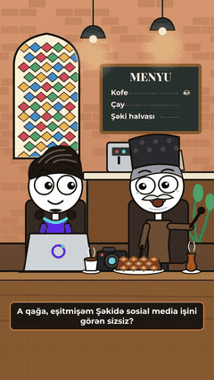</a>
<a href="https://nsrullayevtamerlan29-debug.github.io/ai-animasiya/">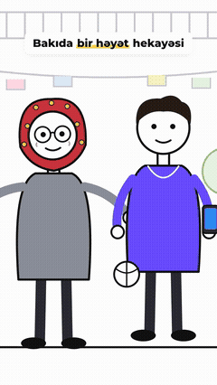</a>
<a href="https://nsrullayevtamerlan29-debug.github.io/ai-animasiya/">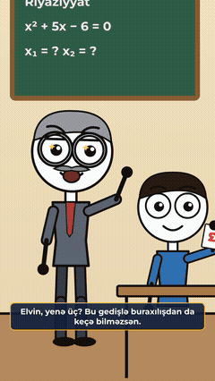</a>
<a href="https://nsrullayevtamerlan29-debug.github.io/ai-animasiya/">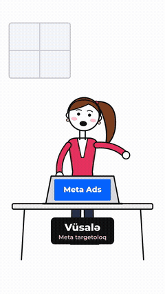</a>
<a href="https://nsrullayevtamerlan29-debug.github.io/ai-animasiya/">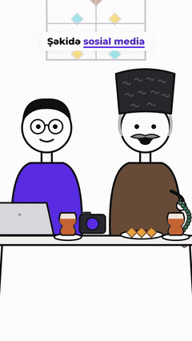</a>
<a href="https://nsrullayevtamerlan29-debug.github.io/ai-animasiya/">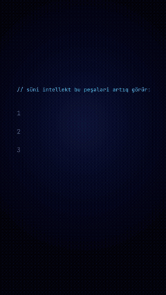</a>
<a href="https://nsrullayevtamerlan29-debug.github.io/ai-animasiya/">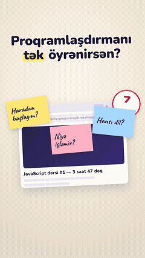</a>
<a href="https://nsrullayevtamerlan29-debug.github.io/ai-animasiya/">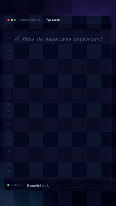</a>
<a href="https://nsrullayevtamerlan29-debug.github.io/ai-animasiya/">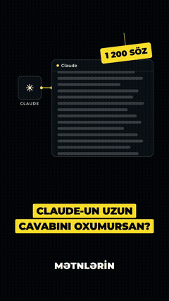</a>
<a href="https://nsrullayevtamerlan29-debug.github.io/ai-animasiya/">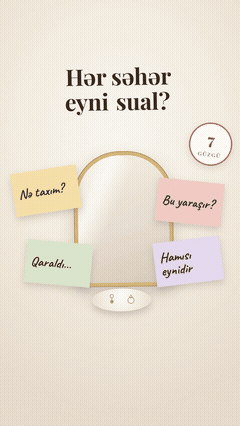</a>
<a href="https://nsrullayevtamerlan29-debug.github.io/ai-animasiya/">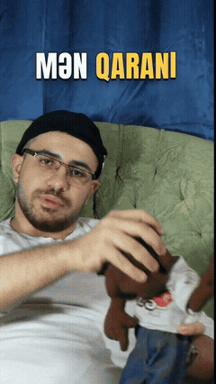</a>
<a href="https://nsrullayevtamerlan29-debug.github.io/ai-animasiya/">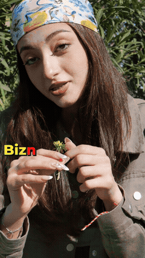</a>
<a href="https://nsrullayevtamerlan29-debug.github.io/ai-animasiya/">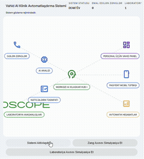</a>

<a href="https://nsrullayevtamerlan29-debug.github.io/ai-animasiya/">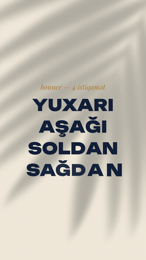</a>
<a href="https://nsrullayevtamerlan29-debug.github.io/ai-animasiya/">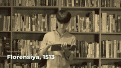</a>

© Tamerlan Nəsrullayev · VOT Agency
